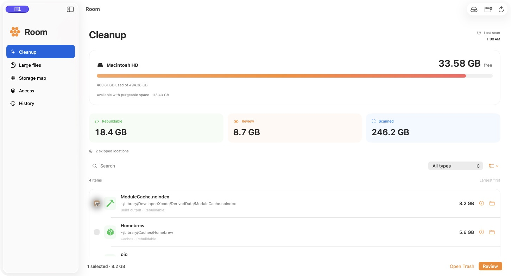

<p align="center">
  
</p>
<h1 align="center">Room</h1>
<p align="center"><strong>See where your disk space goes. Take back what you don’t need.</strong></p>
<p align="center">A native macOS disk utility with a clear view of your files and a review step before every cleanup.</p>
<p align="center"><a href="#install">Install</a> · <a href="#a-clearer-view-of-your-mac">Features</a> · <a href="docs/DEVELOPMENT.md">Build & signing</a></p>

---

https://github.com/user-attachments/assets/0f60acaf-86cb-4dd8-8a9c-25a37d07d4d6



<p align="center"><sub>Illustrative scan results.</sub></p>

## A clearer view of your Mac

Running out of space shouldn’t mean guessing which folders you can delete. Room shows the large files, cached downloads and project output taking up your disk, with the context to make a careful choice.

- **Follow the space.** Drill through a storage map, largest folders first.
- **Find the leftovers.** Surface package caches, compiler caches, old logs and downloaded installers.
- **Keep the important things.** App caches and project output get a separate review category because they can contain local history, offline files or work you want to keep.
- **See the full picture.** Browse large files, reveal anything in Finder, and inspect locations macOS couldn’t scan.
- **Clean with a way back.** Review the exact paths, move selected items to Trash, and restore them from History while they remain there.

Room uses native Mac controls and runs entirely on your device. No account, uploads, third-party packages or background service.

## From full disk to breathing room

1. **Scan your Mac** or choose a folder.
2. **Review what’s taking up space**, with file sizes and an explanation for each candidate.
3. **Move what you choose to Trash.** Empty Trash in Finder when you’re ready to reclaim the space.

Nothing is selected automatically. Room checks the selected files again before moving them. Your projects, model downloads and app data deserve a closer look than a blanket “clean everything” button.

## Install

Requires **macOS 14 or later** and an **Xcode toolchain with Swift 6**. From the project directory:

```sh
make install
open "$HOME/Applications/Room.app"
```

This installs **Room.app** in `~/Applications` and the read-only **room-scan** command in `~/.local/bin`.

For a stable local signing identity, run `make signing-identity` once before installing. Room can also reuse an existing **Iridium Local Signing** identity. [Signing and custom install locations →](docs/DEVELOPMENT.md#local-signing)

For broader scan coverage, add Room in **System Settings → Privacy & Security → Full Disk Access**. The app shows skipped locations under **Access**.

## Your files stay on your Mac

Scans read file sizes and metadata locally. Cleanup uses macOS Trash and records restore locations on your Mac. Room distinguishes immediately free space from space macOS can reclaim, and shows gaps where protected folders or cloud providers limit the scan.

Room leaves system data and snapshots to macOS, and simulator management to Xcode. [How scanning and cleanup work →](docs/DEVELOPMENT.md#scanning-and-cleanup)

## Prefer the terminal?

The same scanner is available as a read-only CLI:

```sh
room-scan ~/Downloads
room-scan --json ~/Projects
room-scan --help
```

Add `~/.local/bin` to your `PATH`, or use `~/.local/bin/room-scan` directly.

---

Built with **SwiftUI**, **Swift Package Manager**, and **zero third-party dependencies**. [Development, tests and local signing →](docs/DEVELOPMENT.md)
